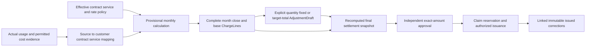
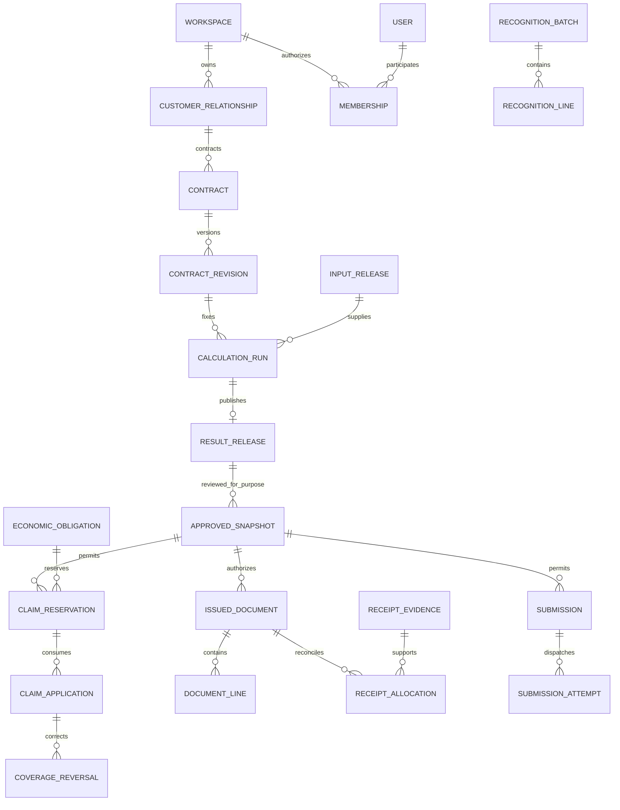

# Logical data schema

## Current decision precedence

The [current owner decisions](../current-design-decisions.md) govern this logical vocabulary. Entity and fact families do not mandate one physical table or service each. Common standardized detail is optional materialization for reuse or replay; marts consume their declared source, calculation and workflow dependencies rather than a universal serial pipeline. The separate policy server owns collection, retention and lifecycle policy; workers enforce it, while pricing and billing approval remain separate. Go backend, Python processing/analysis, React and local Docker are the current direction. Exact schemas, partitions, tenant enforcement, lifecycle races and engine selection still require physical design and verification. No runtime adoption or planning completion is asserted.

## Primary business path: actual usage to adjusted monthly charge

The [usage-driven monthly settlement schema](monthly-settlement-schema.md) is the primary business view. It explicitly restores original service subscriptions, MSP/customer contract rate bindings, direct/resale responsibility, provisional month calculations, complete monthly closing, pre-issuance final amount adjustment and issued corrections. Supplier invoice reconciliation is a conditional source-cost path, not the only way to calculate charges. Monthly settlement here means usage/charge finalization, not cash receipt. Historical review PASS for the initial draft does not certify this redesign.

The full entity/state/precedence/FOCUS and original requirement trace is defined once in the monthly companion. Existing authority, evidence, Claim, receipt, recognition, SaaS and recovery families below support this path. Unconfirmed/partial usage produces labeled estimates only; complete eligible evidence and approved policies produce final candidates. An adjustment grants neither source eligibility nor new economic coverage.

Tracking: [HB-21](https://linear.app/hybrid-billing/issue/HB-21). Accountable owner: Seung Woo Park. Root owns PM/planning and all document edits; separate read-only architect and DBA reviewers assess actual changes. Machine during execution: `mac_mini`. This is a reviewable logical draft, not approved policy, DDL, migration or product implementation.

## Basis and scope

Merged baseline: `b5c65cf66992f703247b8e4713f86cef7835b767`, including HB-16. Architecture input: [HB-19 at 75c4c188](https://github.com/myblueton-sw/hybrid_billing/blob/75c4c188e5d42d682d286cebe9900b2bc0bc660c/docs/architecture/high-level-architecture.md), still proposed in PR15 when drafting. SaaS input: [HB-18 at 6acb38c](https://github.com/myblueton-sw/hybrid_billing/blob/6acb38c68117ff1f1865776aca00f87c61956196/docs/planning/saas-subscription-billing.md), separately proposed in PR14. Capacity/storage input: local HB-20 commit `62f7df1`, `docs/architecture/data-ownership/object-storage-data-architecture.md` and `docs/reviews/HB-20-cost-data/full-review.md`. Its catalog/engine proposals are not adopted here.

The latest premise is **more than 100 million source records/day**, with object storage/Parquet as the recorded data foundation and MongoDB excluded. It is not a measured limit or guarantee. PostgreSQL transactional authority, ClickHouse serving, Kafka, catalog and processing products remain candidates. Logical entities do not prescribe one table/service per row of this document. No numeric bounds, retention duration, node count or SLA is invented.

This draft refines the [existing ownership model](billing-data-model.md), [Claim/numeric contract](../../contracts/billing/claim-and-numeric.md), [input/financial contract](../../contracts/billing/inputs-pricing-and-erp.md), [payment/recognition contract](../../contracts/billing/payment-and-recognition.md), [action registry](../../contracts/commands/planning-actions.md) and [access/trust contract](../../contracts/security/access-and-trust.md). It leaves the original 43 requirement groups, 49 screens and conditional/deferred scope intact. It is not a complete original-source semantic audit or PP-08/09 closure. [Evidence/detail schema](evidence-detail-schema.md) specifies bulk facts, releases and lifecycle. [Verification](../../reviews/HB-21-logical-schema/verification.md) records actual checks and remaining work.

## Common types and reference rules

| Type / convention | Proposed logical meaning and constraint |
| --- | --- |
| `Scope` | `(installation_id, workspace_id)` for tenant-owned data; both server-derived. Installation-global controls have explicitly installation-only scope, never a null-workspace shortcut into tenant data. |
| `ScopedRef<T>` | Scope plus canonical ID and, when historical meaning matters, exact revision. Target must have matching scope. A globally unique ID alone does not permit a cross-workspace join. |
| `Id` / `Revision` | Immutable opaque identity; monotonic owner-controlled revision within an identity. Names, email, file offsets, broker offsets and mutable external IDs are not canonical IDs. Encoding/width remains physical design. |
| `Instant` / `Period` | Explicit-offset instant; `[start,end)` business interval with calendar/timezone revision. Record business-effective and recorded times separately. Date-only accounting periods are not silently converted using server timezone. |
| `ExactDecimal` | Canonical base-10 coefficient/scale under an activated bounded numeric profile; external/API form is a finite decimal string. Submitted magnitude/scale validated before normalization. No float, implicit rounding or default currency scale. |
| `Quantity` / `Money` | Quantity: value, unit and unit revision. Money: value, currency, semantic measure, net/tax/gross basis and numeric/policy revision; FX conversions retain both amounts and exact rate/quotation lineage. |
| `EvidenceRef` | Protected canonical artifact/release reference and digest, not a public raw URL. Ownership, disclosure and retention checked independently. Hashes accelerate identity comparison; full canonical tuple comparison resolves collisions. |
| Optional / unknown | Catalog fields are required unless labeled conditional. Conditional absence carries applicability or unknown reason; missing quantity/amount/coverage is never zero. Physical nullability and field-by-field wire schemas remain pending. |
| Approval / revisions | Versioned content immutable after publication/approval; current pointers/state projections change only through owner commands. New revisions never overwrite historical approved evidence. Current access is checked even for old snapshots. |

Tenant-owned rows carry Scope; child relationships inherit and enforce it. Historical rows carry immutable evidence and policy references; mutable current state carries `revision`, actor/command reference and recorded time. A state projection is authoritative only when maintained atomically by its owner with the immutable decision/effect record. Analytical projections cannot authorize a transition.

Cross-workspace sharing uses a separately approved `ShareGrant` with source scope, recipient scope, exact artifact/revision, permitted rows/fields, purpose, validity and current disclosure decisions at both ends. It never changes the source object's ownership or enables ordinary cross-scope foreign keys. IDs and metadata themselves may be protected.

## Relationship overview

This is a simplified business view, not a complete cardinality diagram. A run publishes at most one fixed result release; recomputation is a new run. A reservation/application can span multiple obligations through explicit links; document lines and contribution detail use bridges, not direct one-to-one source joins. Recognition consumes eligible period evidence independently of customer invoice cadence and has its own purpose-bound approval.

## Identity, parties and effective policy

| Entity / owner | Identity and relationships | Required data / invariant |
| --- | --- | --- |
| `Installation` / operations | Installation ID; 1:N workspaces | Configuration revision, active writer generation, independent control authorities. Operator custody does not grant tenant finance authority. |
| `Workspace` / access | Scope; 1:N memberships/customer relationships | Status, authority epoch, approved tenancy/access profile revision. A workspace is not automatically a company, payer or customer. |
| `User`, `Identity` / identity | Installation user; 1:N identity mappings, unique approved `(namespace, issuer, subject)` | Lifecycle state, identity proof and trust configuration revision. Matching email/name cannot merge users; recreated identities never inherit terminated membership/preferences. |
| `Membership`, `RoleBinding`, `DelegationGrant` / access | User/service principal to workspace; roles and grants scoped to resources/actions/fields | Effective/expiry times, role ceiling, grantor, allowed redelegation chain, policy revision, revocation reference. Hierarchy and MSP relationship grant no implicit access. |
| `Session`, `RefreshFamily`, `ServiceCredential` / identity | Principal/client and approved trust namespace | Verifier/secret references only, expiry, authority epoch, step-up reference, revoked state. Password material, tokens and personal credentials are never design examples or Git content. |
| `TrustChange`, `TrustDecision`, `RevocationDecision` / identity | Connection/change revision; independent proposer/approver and activator | Old/new digests and epoch, affected identities, legitimate proof/recovery refs, approval digest, monotonic activation epoch and invalidation intent. Changed proof/config invalidates approval; rollback is a new epoch. |
| `Party`, `WorkspaceParty`, `CustomerRelationship` / customer | Explicit workspace association to legal actor; 1:N selling/service relationships | Seller/buyer/responsibility roles, governed private profile revision, ERP mapping, effective/recorded times. Similar names and shared payer do not merge relationships. Global Party identity requires approved sharing; private fields stay scoped. |
| `OrganizationNode`, `OrganizationRevision`, `GroupMembership` / customer | Workspace node; acyclic parent graph; overlapping groups allowed | Fixed complete hierarchy revision, effective dates and canonical member IDs. Activation validates whole revision; grouping never double-counts facts or transfers liability/grants. |
| `Contract`, `ContractRevision`, `SourceAccountAssignment` / policy | Customer relationship to seller/buyer and scoped source account; 1:N fixed revisions | Effective interval, explicit direct/resale/internal route, per-component payment responsibility and permitted MSP selling scope, attribution revision, approved service/rate bindings and terms. Reject unsupported overlaps; retroactive changes require impact review. Historical calculations keep exact attribution. Direct CSP usage cannot be implicitly resold. |
| `PolicyRevision` / owning domain | Typed numeric/rate/discount/allocation/FX/tax/payment/retention/access policy | Full content digest, effective scope/interval, independent expected cases where required, approver and activation evidence. Missing required values block activation. One generic policy ID cannot erase domain-specific validation. |
| `NumericProfile`, `FormulaProfile`, `FXEvidence` / calculation policy | Policy-revision subtypes | Magnitude/scale/aggregate bounds, signs, units, allowed operators/budgets, rounding stages/modes/quantum/residual algorithm; FX purpose, pair, quotation numerator/denominator, rate/as-of/source and explicit fallback approval. No universal defaults. |

`FXEvidence` validity guard (B0477.R002, B0463, B0466): a rate is usable for a final candidate only when the exact decimal `rate > 0`, the quotation denominator (source-currency units quoted, for example 100 JPY) is `> 0`, the base/quote pair and direction equal the declared conversion (source currency to target currency for that purpose), the value belongs to an approved FX policy revision, and its as-of/effective time falls inside that policy's approved date, timezone and maximum-staleness window. Inverse and cross rates are derived only through a recorded formula from component rates that each pass this guard. Zero, negative, wrong-pair, reversed-direction, unapproved or out-of-window values block final billing and approval; they are never replaced by the latest value. This guard covers the raw published or approved rate only. FX markup, conversion fees, discounts and other signed monetary components keep their own field-specific sign rules (B0464, B0474); exact decimal arithmetic alone neither rejects a legitimate zero charge nor accepts a nonpositive rate.

Policy ownership, supplier-document, onboarding, plugin, event, enrollment, transfer, commitment, opening-balance, Marketplace, inquiry and ERP/issuance relationship families are bound in [source relationship bindings](source-relationship-bindings.md). In particular, `PolicyRevision` owner Party and delegation follow its [SR-01 section](source-relationship-bindings.md#sr-01-policy-owning-party-and-delegation).

Commercial refinements: `ContractServiceItem`, `ServiceDefinitionRevision`, base `ServiceSubscription`, `SourceServiceMappingRevision`, `RatePlanRevision`, `RateRuleRevision`, `ContractRateBinding`, `PricingSelectionTrace`, `BillingScheduleRevision` and `ContractEvent` use the detailed fields/invariants in the [service/rate catalog](monthly-settlement-schema.md#service-source-and-pricing-bindings). Pricing and FX preserve their distinct source-defined priority ladders; they are not one generic priority field. Conditional SaaS references these shared commercial terms.

## Calculation and fixed approval

`SettlementPeriod`, `MonthlyCloseRevision`, `ProvisionalCalculation`, `ChargeLine`/`RuleTrace`, `FinalSettlementSnapshot` and `BillingCycle`/`CycleSettlementLink` refine this catalog through the [monthly close model](monthly-settlement-schema.md#month-close-and-calculation-entities). ChargeLine is the selling component view of immutable CalculatedComponentFact; InputRelease/ResultRelease below are the typed input/result BusinessReleaseManifest, not competing manifests. AdjustmentDraft/Line/Decision and issued adjustments follow the [distinct before/after issuance paths](monthly-settlement-schema.md#pre-issuance-final-charge-adjustment).

| Entity / owner | Key and references | Required data / invariant |
| --- | --- | --- |
| `CalculationRun` / calculation | Run ID; exact InputRelease or explicitly noneligible provisional observed-input set, monthly close/item/binding and complete policy/contract/org/unit/engine/plugin revisions | Economic period/scope, purpose and provisional versus final-candidate kind, adjustment/selection trace, engine digest and technical/error evidence. Only final candidates from eligible input can enter approval. Retrying preparation does not create fresh economic coverage. Workers cannot approve results. |
| `PoolSnapshot`, `PoolMember` / calculation | Pool ID/revision; unique `(pool_revision, canonical_target_id)` | Complete scope and digest, allowance/tier/min-max/allocation purpose, all weights, denominator, total, explicit algorithm and numeric profile, final conservation totals. Page/chunk/filter never changes membership or allowance. Large member sets live in fixed verified detail. |
| `ReconciliationCase`, `WarningDecision` / reconciliation | Result/evidence revisions and precise affected scope | Expected/observed counts and compatible totals, independent comparison method, differences, blockers; acknowledged warnings bind policy, ceiling, actor and exact evidence. Zero unexplained difference is not a hidden tolerance. |
| `ApprovalSubject` / finance | Typed tuple `(Scope, purpose, snapshot_type, exact_snapshot_ref, digest)`. Source-derived purposes: `final_settlement` and `erp_final_draft` (B0148.R002–R005, B0849) and `recognition_batch` ([payment and recognition](../../contracts/billing/payment-and-recognition.md#monthly-erp-cost-recognition-required-outcome) :44 and :48). Each purpose admits exactly one snapshot type and one dependency set below | The digest covers that purpose's complete dependency set. A subject of one purpose never satisfies another, even when amounts or digests coincide. Unknown purpose or mismatched snapshot type rejects. Adding a purpose requires a reviewed contract revision. |
| `ApprovalRequest`, `ApprovalDecision`, `ApprovedSnapshot` / finance | Exactly one ApprovalSubject; 1:N decisions | Approver, time, segregation evidence, authority epoch and the purpose's authority predicate. Current role/separation/ceiling, the purpose's authority and effect predicates and the unchanged subject digest and dependency set are rechecked at effect. Provisional/adjustment approval alone cannot authorize final billing. Rejection is not deletion; stale draft needs new approval. |
| `NumberSeries`, `IssuedDocument`, `DocumentLine` / finance | Series scoped by issuer/type/legal profile; unique issued number within approved series domain | Immutable approved revision and rendered artifact digest, seller/bill-to, currency/basis, line component/quantity/money and payment-term snapshot. Atomic issuance intent/number allocation with financial gate; voided numbers remain history under chosen numbering policy. |
| `DocumentContribution`, `DocumentClaimLink` / finance | Explicit line to fixed component/contribution and effective ClaimApplication link | Many-to-many lineage with quantity/amount/weight semantics; no join fan-out totals. Prepared links may reference reservations; confirmed economic links reference applications. Document existence alone does not assert an external economic effect. |

| Purpose / snapshot type | Dependency set covered by the digest | Authority predicate | Effect predicate |
| --- | --- | --- | --- |
| `final_settlement` / `FinalSettlementSnapshot` | Exact monthly close, result and input releases, service/rate binding, adjustment, policy, pool, coverage, per-currency net/tax/gross amounts, selling eligibility and target issuer/bill-to | Current selling-policy approver for the seller Party within ceiling; author and approver separated | Permits Claim reservation and, by issuance mode, self-issuance or the draft stage of a `customer_invoice` submission for that exact subject. Never authorizes recognition |
| `recognition_batch` / `RecognitionBatch` revision | Entity/books/basis, accounting and attribution periods, eligible source/calculation period releases, mapping/FX policy, approved cost amounts and reconciliation. No selling settlement, invoice cycle or customer issuance dependency | Current recognition approver for the recognizing entity and books | Permits only the `monthly_recognition` submission of that batch revision; consumes no customer Claim and issues no customer document. Does not wait for invoice cadence |
| `erp_final_draft` / `ERPFinalDraft` revision | Approved `final_settlement` subject reference, ERP connection/profile, MasterMapping revision, returned ERP draft identity/revision, ERP-applied tax/rounding/total and recorded permitted difference amount/cause/rule | Current issuance approver for the issuing legal entity under the ERP mode (B0148.R005) | Permits the posting stage of the same `customer_invoice` submission for that exact ERP draft revision, only while the referenced `final_settlement` subject is still current, unrevoked and unsuperseded. Unexplained difference blocks; an ERP-side change after approval invalidates it (B0849, B0850) |

`ERPFinalDraft` and the issuance-mode relationships are defined in [source relationship bindings FA-12](source-relationship-bindings.md#fa-12-erp-issuance-artifact-and-delivery-relationships).

Approval and issuance, source confirmation, cash receipts, monthly recognition and entitlement status are distinct. Fixed result releases may support separate purpose approvals; an approved snapshot cannot authorize a different target/purpose merely because amounts match. Issued documents and confirmed effects use linked adjustments; no mutable historical amount or silent cancellation cascade.

## Economic coverage and financial conservation

| Entity / owner | Key and relationships | Required data / invariant |
| --- | --- | --- |
| `EconomicObligation` / Claim authority | Unique canonical tuple `(Scope, issuer/responsibility, customer_relationship, contract_id, purpose, economic_component, occurrence_or_coverage_universe, unit_id, unit_revision)` | Full tuple retained with collision-safe registration, expected current revision and source-to-coverage mapping. Unit revision is local to unit identity and cannot identify the unit alone. Run/source revision/request/transport/partition excluded from reset dimensions. |
| `CoverageUniverse`, `CoverageMapping` / Claim/input | Obligation to canonical source economic IDs and corrections | Typed exact coordinates or stable indivisible atoms; explicit unit ID/version, mapping digest, overlap/replacement relationships and eligibility. New decomposition preserves consumed coordinates; uncertain mapping blocks. |
| `ClaimReservation`, `ReservationCoverage` / Claim | Reservation/application group; N:M obligations through disjoint intervals/atoms | Approved snapshot, exact requested coverage, command digest, state/revision, pinned submission and last outcome evidence. Multi-obligation reservation is all-or-nothing over complete overlap domains. Worker lease expiry does not release pinned/unknown scope. |
| `ClaimApplication`, `ApplicationCoverage` / Claim | Unique corresponding economic-effect application; links reservation and all obligation scopes | Confirmed effect evidence, purpose, exact coverage and money separately, fixed revisions and actor. Authoritative current occupancy changes atomically with immutable event; replay returns prior authorized application. |
| `CoverageReversal`, `ReversalCoverage`, `ReplacementAuthorization` / Claim | Named original application and exact subset; replacement links same economic scope | Approved correction, external reconciliation and disposition `cancelled/superseded/replacement_pending/replacement_eligible`. Exclude the union of previous reversal subsets atomically; monetary credit alone frees no coverage. Replacement eligibility is exclusive to its approved link. |
| `CreditAccount`, `CreditReservation`, `CreditApplication`, `CreditReversal` / finance | Account identity `(Scope, authority_system, authority_account, issuing_legal_entity, customer_relationship, currency_or_unit, credit_kind)` (B1484); every movement/reservation/application/reversal carries the full account identity, its own ID, original links, source document/revision and external transaction ID, exact Money or Quantity, lifecycle state, submission/evidence refs and expected balance revision | Promotional credit, prepaid cash, credit document and refund capacity are separate kinds; monetary credit is per currency and included quantity per unit (B1481.R002, B1484). An application may target only a document or obligation whose issuing legal entity and authority account equal the account's; workspace or customer match alone never pools balances across issuers. Cross-issuer use rejects. HB-23 derived proposal, conditional on an adopted transfer decision: an approved transfer rule revision may name source and target accounts, kind, currency, cumulative ceiling per rule revision and effective interval; consumption under earlier revisions of the same source and target pair is carried forward and shown at approval, so a new revision never silently resets it; it needs separated approvals from authorized approvers of both the source and the target issuer, and each transfer records linked typed transfer-out and transfer-in movements under both authorities. Prevent overspend including pending/unknown applications; effective cumulative reversals cannot exceed the original effective application. External balances require verified external reservation or approved manual reconciliation; local locking cannot reserve ERP value. Opening balances follow [FA-11](source-relationship-bindings.md#fa-11-commitment-opening-balance-marketplace-final-work-and-inquiry). |

Coverage states are per interval/application, not an obligation-wide consumed boolean. Empty/reversed/duplicate/overlapping intervals reject; atoms cannot be partially consumed. Quantity coordinates have explicit economic allocation meaning. Reservations pin before external dispatch. Release requires proof of no dispatch/effect or reconciled cancellation of the pinned operation; confirmed effects require consumption plus governed reversal. Cumulative scalar reversal totals alone cannot detect overlapping subsets.

The first proposed consistency boundary is one coordinated transactional financial authority per installation/profile. It contains compact exact coverage registries and protected bulk lineage references; it does not require one obligation per input row. Cardinality, maximum atom/interval count, hot-domain locking and multi-obligation transaction size are OPEN. An oversized operation blocks or receives a separately reviewed business-boundary redesign; no silent eventual split across shards.

## Receivables, recognition and external effects

| Entity / owner | Key and relationships | Required data / invariant |
| --- | --- | --- |
| `PaymentTermSnapshot`, `PaymentExtension` / receivables | Invoice/schedule identity and immutable initial terms; new approved extension revisions | Confirmed invoice issue date as term basis, nonnegative integer net days, approved calendar/zone, original and effective due dates, exact approval and reason. Delivery/receipt/redispatch cannot restart terms. Generic schedule rights cannot extend an issued debt due date. Missing/contradictory terms block issuance. |
| `ReceivableEvidence`, `ReceiptEvidence` / receivables | Unique external/manual authority namespace/account/entity/object/revision | Invoice correlation, amount/currency/basis, verified status/as-of, provenance and freshness. Missing/stale evidence means unknown, not zero balance. One selected cash/receivable authority per profile. |
| `ReceiptReservation`, `ReceiptAllocation`, `ReceiptAllocationReversal` / receivables | Receipt to invoice/receivable evidence; reservation/allocation/reversal IDs, exact named original link, Money, lifecycle state, submission/evidence refs and expected balance revision | Pre-confirmation reservation distinct from confirmed allocation; atomic currency-compatible allocation tracks remaining confirmed amount and reserved/unknown effects. Effective cumulative reversals cannot exceed the original allocation. Cumulative allocations/reversals conserve value; payment attempt success or payout alone cannot settle an invoice. |
| `RecognitionBatch`, `RecognitionLine` / recognition | Entity/books/basis/accounting period/purpose and fixed revision | Eligible source/calculation period releases, mapping/FX policies, approved cost amounts and reconciliation. Approved through its own `recognition_batch` ApprovalSubject, never through a selling settlement subject; that subject maps only to the `monthly_recognition` submission purpose (payment-and-recognition :44). Missing month blocks completeness; billing cadence never starts or repeats recognition automatically. |
| `RecognitionBillingLink`, `RecognitionAdjustment` / recognition | Period cost/effect to invoice/adjustment coverage and original posting/application refs | Adjustment ID/revision, confirmed monthly net revision, inclusion disposition (`already_in_monthly_net` or `bridge_only`), customer/contract/attribution/entity/books/currency/basis/tax reconciliation scope, external confirmation/as-of and approved offset/reversal/reference treatment. Already-included adjustment contributes zero bridge amount; unresolved inclusion/confirmation blocks final reconciliation. Closed-period change uses approved open-period adjustment retaining attribution period. |
| `Submission` / originating finance/service owner | Immutable purpose/target-account/entity/fixed snapshot and economic intent identity | Payload digest, approved action, correlation/idempotency identity, expected owner revision, holds, desired effect state and last evidence/as-of. Existing intent reused after timeout; transport success is not business success. |
| `SubmissionAttempt`, `ExternalResult`, `ExternalMapping` / integration | 1:N attempts for one intent; unique external identity in target account/purpose domain | Fenced worker generation, dispatch/received time, adapter/profile revision, authenticated result proof, amount/currency and owner disposition. Conflict/wrong account/out-of-order result quarantined. No new attempt that may duplicate unknown effects without reconciled safe evidence. |
| `InboxRecord`, `OutboxRecord` / owning authority | Target/provider account + event identity; committed domain intent + event ID | Digest/conflict state, schema version, correlation, sequence/revision and acknowledged checkpoint. Immutable duplicate versus conflicting payload distinguished. Delivery may repeat; consumer economic effect remains unique. |

## Conditional SaaS and payment entities

These refine the separate HB-18 proposal; inclusion in this draft is not merge, activation or accounting-policy approval. They extend existing customer/contract/financial identities rather than introducing a competing tenant or money ledger.

| Entity / owner | Key and required fields | State and conservation boundary |
| --- | --- | --- |
| `CatalogItem`, `PriceRevision` / commercial policy | Scoped product/plan/add-on identity, exact approved currency/unit/price revision, recurrence interval, complete allowance/tier policy and effective interval | Migration/grandfathering rules explicit; mutable catalog labels cannot rewrite historical prices. |
| `Subscription`, `SubscriptionRevision`, `SubscriptionItem` / subscription | Customer/contract/service-instance refs, exact price/item revision, trial/start/renew/end, billing anchor/calendar, advance/arrears and seat/meter/proration policy | Draft/trial/active/paused/ended and scheduled changes are separate from payment, issuance and service state. Effective and recorded times retained; cancellation does not erase debt/evidence. |
| `SubscriptionChange`, `ChangePreview` / subscription | Expected subscription revision, exact before/after item/price/policy digest, effective interval, requested actor, proposed quantity/credit and approved decision | Missing proration/seat/allowance policy blocks financial finalization. Stale preview cannot apply; concurrent renewal/cancel/change serialized. Customer request is not financial approval. |
| `MeterDefinition`, `SeatObservation` / input | Scope/service-instance, measurement grain/revision, event/counter semantics or assigned/active/peak/time-weighted seat rule, window, exact quantity/unit and lineage | Metered data follows ordinary input confirmation. Login count is not an implicit seat rule; cumulative snapshots and events not double-counted. Recurring economic occurrence IDs survive job/revision retry. |
| `PaymentMethodReference`, `MandateEvidence`, `PaymentAttempt` / payment integration | Opaque method/provider-account refs; separately approved consent/mandate/security policy; fixed invoice/charge approval, amount/currency, original intent and provider correlation | No raw card data or automatic debit authority inferred. Prepared/authorized/pending/unknown/confirmed states; verified result must reconcile with receipt authority and allocation before invoice settlement. |
| `PaymentProviderEvent` / payment integration | Typed InboxRecord/ExternalResult specialization: provider-account/event identity, exact attempt/original intent, verified signature/audience/replay evidence, amount/currency, provider sequence/as-of and canonical payload digest | Same event/body deduplicates; changed body conflicts. Wrong account/amount/currency or stale events quarantine rather than settle another invoice or revive superseded state. No second receipt ledger. |
| `RefundReservation`, `RefundIntent` / finance + payment integration | Original confirmed payment/receipt reference, approved refund policy, amount/currency, eligible unrefunded capacity, pending/unknown reservations and separate external effect identity | Do not exceed unrefunded capacity. Credit document/refund request/confirmed cash refund are distinct; unknown refund remains reserved. External capacity needs verified reservation or blocked/manual path. |
| `EntitlementRevision`, `EntitlementDelivery`, `EntitlementAcknowledgment` / service | Subscription/service-policy revision, target service, features/seats/quotas, desired generation, applied generation and last verified outcome | Stale callback cannot regrant old desired state. Unknown delivery is not applied. Grace/suspension/regrant needs approved policy; login authorization and retained billing access remain separate. |

SaaS MRR/ARR/churn metrics require versioned inclusion definitions and per-currency basis in derived reporting; they are not accounting revenue. SaaS revenue/deferred-revenue treatment remains a separate unresolved accounting contract, not customer invoice total divided by twelve.

## Jobs, holds, query and intelligence metadata

| Entity / owner | Required key/data | Boundary |
| --- | --- | --- |
| `CommandOperation` / command owner | Unique `(installation, client, command_id, idempotency_key)`, bound principal, resolved Scope/target, canonical payload digest, expected revision, result/evidence refs | Different principal/body conflicts; authorized replay does not rerun effect. Recheck access before protected prior-result disclosure. |
| `Job`, `JobTargetManifest`, `JobCheckpoint` / workflow | Fixed command/target revision, actor/client, current authority reference, installation generation, lease/fence token, bounded retry policy, counts and partial/error state | Durable acceptance is not business success. Revocation changes permitted output completeness; job/lease cancellation releases no financial reservation. |
| `BusinessHold`, `HoldTarget`, `HoldOperation` / corresponding domain | Distinct billing/delivery/collections hold ID/type; exact partial target manifest, expected revisions, actor/approval and local versus external states | Legal retention hold separate. Releasing one hold cannot clear others or automatically resume work. Unknown external release retains uncertainty and last confirmed state. |
| `StageSchedule`, `ScheduleChange` / workflow | `(cycle_id,schedule_id,stage)`; original/current deadline, timezone/calendar, completion predicate, exact proposed/approved digest and history | Several schedules per stage allowed; changing delivery does not change approval/payment. Payment update only from separately approved finance extension. |
| `OnboardingCohort`, `AttemptUnit`, `MilestoneEvidence` / onboarding | Frozen cohort/policy/cutoff, canonical attempt unit, retry links, connected and verified outcomes, classified intervals | Separate denominators/outcomes; interval union handles overlaps. Counts/identities current-authorized. Missing milestones/time evidence are unknown. |
| `Favorite` / preferences | Unique scoped user/customer relationship; preference and lifecycle policy revision | Personal record grants no customer access. Revocation purge versus bounded hidden retention and regrant restoration require approved policy; no inherited favorites after termination. |
| `ProjectionRelease`, `QuerySnapshot`, `ExportArtifact` / reporting | Exact source releases/scope/schema/filter/sort/cursor; completeness/as-of, numeric basis, recipient authority and artifact digest/expiry | Query filters eligible rows before aggregation. Current field/resource access governs metadata, generation and release; a historical manifest freezes economics, not grants. |
| `AnalysisRun`, `RetrievalSnapshot`, `Finding`, `ProposalDecision` / intelligence | Authorized fixed releases, permitted citation refs, model/prompt/tool policy versions, feature/index lineage, output digest and disposition | Recheck rights before retrieval/context/output. Findings remain advisory; accepted proposal references an ordinary authorized command. No direct money write or default external transmission/training. |
| `IndexRelease`, `IndexEntry`, conditional `TrainedArtifact` / derived data | Corpus/index revision, source document/artifact/chunk/field/policy lineage, owner scope, schema/model revision, completeness, withdrawal eligibility, deployment/backup inventory and control watermark | Indexing permission grants no retrieval permission; current row/field controls apply before context/output. Pre-eligibility evidence supports labeled collection findings only, never financial eligibility. Missing lineage blocks use. Training requires independent approval. Withdrawal fences linked versions/deployments; backup cannot revive them. |

`OnboardingCohort` metrics are not readiness authority; operational onboarding records, source-result return and external event delivery, enrollment and authentication policy, plugin lifecycle and customer transfer are bound in [source relationship bindings](source-relationship-bindings.md) sections FA-06 to FA-10. `InboxRecord`/`OutboxRecord` remain generic carriers and do not replace those typed relationships.

Secrets remain in approved secret stores and only opaque references enter metadata. Protected prompt/context bodies, raw customer data and card/security-code material are not needed in this schema document. Product storage of sensitive content requires separate lawful disclosure/retention policy, not a generic unbounded audit payload.

## Atomic state boundaries

| Boundary | Proposed serialized decision | Durable failure behavior |
| --- | --- | --- |
| Input publication | Verified fixed evidence + lifecycle pins + current candidate/scope revisions + current confirmation/publication authority → immutable InputDecision, eligible pointer, dependencies and outbox | Catalog/object write cannot grant eligibility; conflicting publisher loses without overwriting winner. Unknown preparation/commit reconciled before cleanup or retry. |
| Financial effect | Exact approval/authority/separation + all Claim/credit overlap domains + independent holds + number/intent rules → reservation/pin, local document/intent and outbox as applicable | All-or-nothing within declared boundary; no external transaction assumed atomic. Confirmation applies/reverses exact intent separately; unknown stays pinned. |
| Trust activation | Approved old/new digest + independent authority + expected epoch → newer epoch/configuration and invalidation outbox | Consumers fail closed on stale epoch; asynchronous propagation status separate from activation. |
| Receipt/recognition | Verified purpose-bound external evidence + balances/period mappings + expected revisions → linked allocation/posting disposition | Local projection never invents bank/ERP authority; conflicting or stale evidence blocks automatic update. |
| Lifecycle / resume | Current dependencies/holds/pins/control sequence + writer fence → approved removal/publication/resumption | Shared-file cleanup, restore and AI index use cannot resurrect denied/deleted data or free Claims. Missing latest controls means quarantine. |

## Planned schema acceptance and unresolved choices

These are proposed documentation-derived cases, all product execution **NOT_RUN**. Existing CL/NM/IC/TC/PT/ERPC/QG/UD cases remain authoritative source references; this list does not create new requirement groups.

| Case | Expected outcome / source |
| --- | --- |
| LS-01 scope | Cross-workspace child reference, shared payer ID and stale grant cannot read/join/export protected rows; authorized sharing checks both ends. QG-01–04. |
| LS-02 publish race | Competing confirmation/GC/publication either keeps pins and one exact eligible release or blocks/conflicts; stored bytes/catalog head alone never eligible. IC-01–06, UD-08. |
| LS-03 coverage | Reserve `[0,60)` and `[40,100)` concurrently; one wins. Distinct reversals `[20,40)` then `[30,50)` conflict. New source/run cannot reset coverage. CL-01–08. |
| LS-04 uncertainty | Dispatch timeout + lease expiry + restore preserves pinned coverage and original external identity; proof required before release/new effect. CL-03, F06/F12. |
| LS-05 numeric | Exact decimal and signed quantum residual cases reproduce under every chunk/order; missing bounds, mixed basis/currency and fan-out reject. NM-01–06. |
| LS-06 independent state | Invoice cancellation changes no receipt, recognition or entitlement without its own authorized linked action; monthly evidence remains independent of annual billing. PT/ERPC and proposed SB cases. |
| LS-07 authority | Trust rollback requires new epoch; old session/queued job blocks; replay result inaccessible after revocation. TC-01–03, IC-04. |
| LS-08 history | Historical lineage/totals retain original org/policy/input revisions under current access; retention clocks unchanged by compaction/restore. UD-01–09. |
| LS-09 scale | Measure source/detail/component/bridge/obligation cardinalities and burst/close/catch-up, atomic transaction limits and query/GC load. No per-row SQL Claim assumption. UD-10 and HB-20 premise. |
| LS-10 AI | Index deletion/revocation mid-retrieval suppresses context/output; missing source lineage and unapproved trained artifacts are ineligible. QG-04, TW-01, F11/F12. |
| H23-S01 approval purpose | An approved `final_settlement` subject is presented to authorize a `monthly_recognition` submission for the same month and amount: rejected as purpose/snapshot-type mismatch. B0148.R002, payment-and-recognition monthly path. |
| H23-S02 independent recognition | A RecognitionBatch for an internal-only enterprise with no selling contract is approved and submitted through its own `recognition_batch` subject without any FinalSettlementSnapshot or invoice cycle. B0010, B0026. |
| H23-S03 ERP final amount | Approved selling net is sent as ERP draft; ERP returns a total that differs by an unexplained amount: `erp_final_draft` approval is blocked; a recorded permitted rounding difference with cause/rule may be approved; ERP edit after approval invalidates it. If the referenced `final_settlement` subject is superseded or revoked after the draft was returned, posting under the `erp_final_draft` approval is rejected. B0849, B0850. |
| H23-S04 issuer credit isolation | Same customer and workspace, issuers E1 and E2; promotional credit 100 USD in E1's account cannot be applied to an E2 invoice. B1484. |
| H23-S05 approved cross-issuer transfer | FA-02 Required (HB-23 derived proposal, conditional). E1 promotional USD account starts at 100 USD; an approved E1→E2 rule revision for kind promotional, currency USD, has cumulative ceiling 40 USD and approvals from both issuers: a 40 USD transfer leaves E1 at 60 and adds 40 to E2 through linked transfer-out/in movements; a further 1 USD under the same revision rejects; a rule approved only by E1 rejects; without a rule, transfer rejects. |
| H23-S06 concurrent issuer-scoped application | Confirmed credit 100 USD in one issuer account applied concurrently to 60 and 50 USD invoices of that issuer: total application 100, remaining payable 10, no double consumption. B1485. |

Open decisions: approved tenancy/Party-sharing profiles; exact source identity and multiplicity; customer numeric/FX/calendar/tax/proration values; lawful contact/payment fields; supported external authority and no-effect proofs; final finite state/error vocabulary; physical constraints/types/index/partition layout; table/catalog commit/pin/fence protocol; retention/replay horizons and independent control freshness; bounded batch sizes, access/latency/close targets, RPO/RTO and named operations/finance/security decision owners. No unanswered choice receives an automatic default.

Next: review the logical boundaries and schema gaps, obtain profile values and complete requirement/action/scenario mapping, then specify physical layouts and engine/version compatibility as design documents. Executable DDL, migrations and performance prototypes remain prohibited until explicit owner planning completion.
