# Usage-driven monthly settlement schema

Tracking: [HB-21](https://linear.app/hybrid-billing/issue/HB-21). Owner-requested redesign of the initial draft, not new product scope. Root owns document edits; independent architect/DBA review remains separate. This document is the primary business path within the [logical schema](logical-data-schema.md), with [bulk evidence](evidence-detail-schema.md) and unchanged authoritative [financial](../../contracts/billing/inputs-pricing-and-erp.md), [Claim/numeric](../../contracts/billing/claim-and-numeric.md), [payment/recognition](../../contracts/billing/payment-and-recognition.md) and [action](../../contracts/commands/planning-actions.md) contracts. Names/fields/state machines below are logical proposals, not implemented storage or approved customer policy values.

## Restored requirements and source meaning

Authorized local v1.16 `requirements.md` HB-14/15/16/17/18/23/29 and `detailed-requirements.md` AR-01/04/06/07/10 already require complete-pool allocation, effective service subscriptions, distinct sales pricing modes, deterministic formula traces, source-versus-sales FX, direct/resale eligibility, pre-issuance quantity/fixed/target-total adjustments and immutable issued corrections. Original references include B0033/B0123, B0486.R007/B0495, RATE01/COM07/REV01 and AUD-AR-01/04/06/07/10. These local inputs are authorized but not fully published; this document restores their identified semantics without asserting full English baseline/source audit closure. Requirement HB identifiers in those files are source-group IDs, not newly created Linear tickets.

**Monthly settlement means finalizing usage and customer charges for a defined service period; it does not mean cash settlement.** Actual usage is the central input. A supplier's final invoice is a separate cost/reconciliation source and is not a universal prerequisite to calculating customer charges. CSP provider pricing/commitment amortization is not reimplemented: provider-supplied cost bases are consumed when the approved cost-linked selling contract requires them. Independent contractual usage tariffs use verified quantities and applicable commercial policy. Assigned capacity/reservation/fixed charges remain supported according to contract; observed CPU percentage cannot replace historical capacity or contractual quantity.

Source input confirmation validates fixed evidence, attribution and required independent comparison; final monetary approval validates the computed and adjusted selling amount. Neither substitutes for the other. Partial/unconfirmed input can support a clearly labeled nonauthoritative preview only under permitted disclosure; it never becomes an approvable result or consumes Claims.

## Primary relationships and ownership

```mermaid
flowchart LR
    Usage[Actual usage and permitted source cost evidence] --> Map[SourceServiceMappingRevision]
    Map --> Item[ContractServiceItem and effective ServiceSubscription]
    MSP[MSP seller responsibility and policy templates] --> Binding[ContractRateBinding]
    Item --> Binding
    Binding --> Preview[Provisional calculation with fixed observed inputs]
    Preview --> Close[MonthlyCloseRevision: full coverage and complete pools]
    Close --> Base[Fixed base ChargeLines and RuleTrace]
    Base --> Adjust[AdjustmentDraft: quantity fixed or target total]
    Adjust --> Final[Recomputed final ChargeLines and exact result digest]
    Base --> Final
    Final --> Approval[Independent final amount approval]
    Approval --> Claim[Claim reservation and authorized issuance]
    Claim --> Invoice[IssuedDocument and immutable line links]
    Invoice --> Correction[Linked issued adjustment and external reconciliation]
    Costs[Supplier invoice and selected cost authority] --> Close
```

The supplier-cost arrow is conditional on the selected contract basis. Allocation-only enterprise/group operation needs no fictitious MSP. The same scoped customer/Party/contract model supports MSP selling and internal showback/chargeback; operating mode and payment responsibility determine which financial effects are legal. Monthly cost recognition and cash receipts remain their separate existing paths, not steps inferred from this diagram.

## Service, source and pricing bindings

All records use the logical schema's Scope, exact decimal/unit/Money types and ownership-aware references. Approved effective revisions are immutable. Missing mapping, same-priority ambiguity, overlapping unsupported bindings or missing policy blocks affected finalization; never select the first matching row or current display name.

| Entity / owner | Required key and fields | Constraint / relationship |
| --- | --- | --- |
| `ContractServiceItem` / customer-commercial | Scoped item ID; contract/customer/seller/buyer/service refs; `transaction_route` direct/resale/internal; component payment responsibility, permitted issuer and selling-eligibility policy; applicable source/service scope | One contract has many items. Direct-contract CSP usage is cost/showback evidence, not eligible MSP reselling; separate service-fee components remain possible. Recheck responsibility at calculation, approval and issuance; input account ownership grants no selling right. |
| `ServiceDefinitionRevision`, `ServiceSubscription` / commercial | Canonical service/component/unit/grain; subscription/item ID, service-instance/resource refs, effective and recorded intervals; quantity/capacity history, start/pause/renew/end and proration/advance/arrears policies | Base service subscriptions are original HB-15 scope, not conditional SaaS-only. Lifecycle does not delete CSP resources or erase liability. Historical interval splits reproduce mid-month quantity/rate changes. Conditional SaaS SubscriptionRevision specializes these commercial refs; no competing subscription ledger. |
| `SourceServiceMappingRevision` / input + commercial | SourceProfile/schema version/account, service/SKU/meter/resource/model/version/endpoint predicates as applicable, customer/contract/item refs, attribution interval, unit conversion/denominator and supported source multiplicity | Exact verified mapping, separate source-native and canonical service IDs. FOCUS/account/subaccount/tags are mapping evidence, never permission or automatic contract identity. Mapping change invalidates affected unissued candidate/result review; ambiguous mapping is quarantined. |
| `RatePlanRevision`, `RateRuleRevision` / selling policy | Service/component and exact approved effective revision; pricing mode, unit/denominator/currency, numeric/formula/FX/tax refs, rule parameters, allowance/tier/min-max pool, discount/fee order and eligibility | Modes explicitly distinguish passthrough, markup, target_margin, fixed_unit, fixed_period, graduated_tier, whole_volume_tier, included/overage and bounds. RatePlan is a typed PolicyRevision; SaaS PriceRevision references its applicable rate terms instead of duplicating financial truth. Actual rate values remain customer policy. |
| `ContractRateBinding` / commercial | ContractServiceItem, exact rate-plan/rule/template revision, effective interval, exception predicates and approved priority/fallback; when cost-linked, selected source measure/basis/currency/period and eligible component policy | N effective bindings across item history; one resolved policy per conflicting decision scope. Independent tariff needs quantity but not an invented supplier cost. Cost-linked tariff blocks finalization when required cost is missing/stale; quantities may still be previewed as nonauthoritative. |
| `PricingSelectionTrace` / calculation | Fixed candidates/predicate evidence, chosen binding/rule/revision, priority, permitted default reason, complete pool scope and input revision | Preserve source precedence: SKU exception → service/contract → explicit group template → default. Separately resolve FX customer exception → contract default → MSP default with approved fallback. Never conflate these ladders. Service/company labels cannot resolve collisions. |
| `BillingScheduleRevision`, `ContractEvent` / commercial + workflow | Subscription/contract/item refs, usage period, customer billing cadence/anchor, timezone/calendar, approved interval/split policy, change reason/actor/effectivity | Monthly close is separate from invoice grouping/quarterly billing, recognition period and Payment Terms. Annual/quarterly invoice can reference multiple fixed monthly releases without repeating occurrence charges/allowances. |

Synthetic pricing distinction: cost 100 with 20% markup yields 120; 20% target margin yields `100/(1-0.20)=125`. They are separate modes, not a generic percentage. Original HB-17 requires target margin at or above 100% to reject before policy activation and calculation; exact signed division alone cannot enforce this when a value above 100% would produce a negative denominator. Other allowed signs/ranges remain field-specific approved policy. Full-pool thresholds/allowances/minima cannot be applied per page/chunk. Usage-based, fixed and capacity charges carry distinct economic component/occurrence IDs so overlapping source measurements cannot create duplicate billing.

AI usage policy includes explicit successful/failed/cancelled/incomplete-stream eligibility, model/version/endpoint, token category inclusion and 1K/1M pricing denominator. Supplier charging and customer selling eligibility are separate. On-prem/DC items explicitly record included power/service versus additional usage, reserved GPU base versus actual overage and independent SLA-credit policy/evidence. An incident alone creates no financial credit; included charges cannot be sold twice.

## FOCUS and other incoming money

| Data | Treatment in this model |
| --- | --- |
| Actual measure | Retain consumed/pricing quantity, exact unit/grain/window and measurement profile. Pricing quantity and consumed quantity need explicit semantic conversion; one is not blindly substituted for the other. |
| Source cost columns | Preserve source schema/profile/revision and separate Billed/Effective/List/Contracted measures with billing/pricing currency and native dimensions as supplied. Four alternate bases are not summed. Unsupported/missing basis stays unknown; no synthetic zero or inferred provider contract price. |
| Source invoice/correction | Reconcile required billed basis against compatible invoice scope/currency/period; Effective basis can legitimately differ. Purchase/covered-usage inclusion follows approved basis to avoid double counting, not blanket Purchase exclusion. |
| Selling calculation | Select ContractRateBinding and current selling eligibility. Preserve source costs; produce separate customer ChargeLines with mapping/rule/component lineage. FOCUS ContractedCost is source contract evidence, not automatically the MSP/customer rate. Source discount/tax/credit does not automatically become a selling discount/tax/credit. |
| Unknown supplier cost | Independent approved tariff can finalize from complete verified usage when its contract does not require supplier cost; show profitability/cost as unknown. Cost-linked charge remains nonfinal until required authority is available. This never waives mandatory independent input comparison or confirmation. |

This maps existing source semantics, not new FOCUS-version adoption. An exact source/profile version and all required fields/capabilities must be verified before activation. The [evidence schema](evidence-detail-schema.md) retains original cost records and typed normalized quantities/components; the business selling layer never rewrites them.

## Month-close and calculation entities

| Entity / owner | Required key and fields | State and invariant |
| --- | --- | --- |
| `SettlementPeriod` / commercial | Scope/contract/period ID, usage `[start,end)`, calendar/zone, required source/item coverage, cutoff and late-arrival policy, cost-basis prerequisites, full pool scope refs | A period contains all dependent contract items and pools, not merely the viewed customer/page. Monthly valuation can feed a distinct invoice cycle. Date/cutoff alone proves neither completeness nor approved finality. |
| `MonthlyCloseRevision` / financial workflow | Period ID/revision, immutable close target/input manifest set, mapping/attribution/contract/service/rate/FX revisions, confirmed coverage/comparison decisions, close cutoff/as-of, exact typed totals and reconciliation findings | Proposed preparation states open/provisional/closing/blocked/reconciled; fixed final snapshot has independent approval state. Multiple revisions preserve late arrivals; an approved/issued revision is never reopened in place. Concurrent closer checks expected period revision and full dependency/pool boundary. |
| `ProvisionalCalculation` / calculation | Fixed observed source/candidate refs, actual-versus-estimated quality, mapping/rate snapshots, observed window/completeness, run/result and missing prerequisites | Clear estimate/as-of/incomplete label; no eligibility or approval/issuance/Claim authority. If a run mixes missing required supplier costs/coverage, final publication blocks rather than treating omissions as zero. Provisional status is not a different tariff or exemption. |
| `ChargeLine`, `RuleTrace` / calculation | Fixed result/close/item/binding/rule refs, component/occurrence, source contribution refs, original quantity/unit/cost-basis, selling Money, stage operands/sequence/rounding and pool/FX lineage | Selling specialization of CalculatedComponentFact, not another ledger. Immutable base and adjustment components remain separate. Original supplier cost, allocated cost and customer sales remain distinct; exact trace records selected policy and eligibility. |
| `FinalSettlementSnapshot` / finance | Exact revised close/result, complete base+adjustment line manifest, input/policy/pool/approval-dependency digest, per-currency/net-tax-gross totals, unresolved requirements and lifecycle pins | Result proposal awaiting human amount approval. ApprovalRequest references this exact digest and full dependent scope. Editing any upstream draft invalidates approval; only a new verified revision can proceed. No issued customer subset before entire dependent shared pool is validated. |
| `BillingCycle`, `CycleSettlementLink` / finance | Customer invoice cycle and permitted grouping policy; fixed period/snapshot/line/occurrence links, issuer/bill-to/currency/basis and covered scope | Consume each eligible economic component once through existing Claim authority, not a settled boolean. Monthly closing approval does not itself authorize quarterly submission, reset Payment Terms or imply monthly recognition confirmation. |

Calculation order remains quantity/target → base selling price → discount → fees → min/max → FX → selling tax/rounding, with separately approved exception revisions. Independent tariff calculations cannot reconstruct missing source detail. The complete pool includes MSP/operating burden and explicit remainder where required; conserving customer totals alone is insufficient.

Register authoritative dependency edges from each unissued final snapshot and invoice cycle to every monthly close, source/item/mapping/rate/pool/reconciliation revision and current affected economic-scope generation. Publishing a relevant replacement revision or changed prerequisite marks every dependent unissued aggregate/approval stale even though the old immutable month was not edited. Effect-time validation compares the pinned set and recorded scope generations with current authoritative dependency state; unresolved/missing impact traversal blocks issuance. Recompute and approve a new complete aggregate, never silently swap one month inside an old approval. Already issued or externally pinned/unknown cycle remains immutable and pinned; late impact enters its linked correction/reconciliation path, not fresh issuance or automatic release. Technical freshness alone neither changes historical economics nor authorizes retaining a superseded draft.

## Pre-issuance final charge adjustment

| Entity / owner | Required key and fields | Guard |
| --- | --- | --- |
| `AdjustmentDraft` / finance | Scoped adjustment ID/revision, unissued original close/run/result/line refs, affected item/pool/period manifest, kind quantity/fixed_amount/target_total, old/proposed Quantity or Money, reason/evidence, author, current permissions, approval and expected base/adjustment revision | Source and original ChargeLines immutable. Target total names scope, currency, net/tax/gross basis and fixed current-result digest. Generic edit of invoice total is prohibited. Changing any parameter/evidence/base invalidates adjustment preview and approval. |
| `AdjustmentLine`, `AdjustmentComputation` / calculation | Draft and immutable applied revision, base line/scope link, before/target/result Money, explicit signed delta, typed basis/currency, affected quantity, tax/FX/pool recomputation, exact algorithm/rule version and full impact manifest | AR-07 delta is target minus current **at the same declared basis**. Quantity correction recalculates affected pricing pools; fixed amount enters its explicit policy-selected stage. No blanket delta after tax/FX or silent inverse-rate guess. Gross-target allocation requires a deterministic approved tax/rounding rule and feasible exact target; otherwise block. |
| `AdjustmentDecision`, `SettlementAdjustmentLink` / finance | Exact proposed/computed digest, author/independent approver, decision/authority/ceiling and rationale, expected target revisions; close snapshot to unique applied adjustment revision | Adjustment approval does not replace final amount approval. Apply atomically once; same-intent replay returns existing authorized revision, distinct stale/overlapping targets conflict. Multiple target-total requests bind the revised current result so previous adjustments are not added twice. |

Proposed flow: draft → complete impact computation → validated or blocked → independently approved/rejected/cancelled → applied to a new unissued result revision. Recheck current authority/separation, expected base revision and all evidence at apply. Final whole-result reconciliation and human approval follow. Current issuance/pinned submission serializes with adjustment application: once effects are issued or potentially dispatched, reject the pre-issuance path and use the governed correction/reconciliation path; unknown dispatch is not proof the document is unissued.

Synthetic net-target case: base selling net 1,000; proposed final net 900 → explicit net adjustment −100. Recompute tax/rounding under approved policy and approve resulting net/tax/gross digest; no example tax rate is supplied. The same request produces one −100 application. A later target net 850 against revised net 900 adds −50, retaining both effects and original base. A gross target cannot reuse this net delta without its approved tax allocation.

Manual quantity/fixed/target adjustments do not conceal unresolved source errors or bypass selling eligibility, completeness, warning blockers or whole-pool conservation. Monetary-only adjustments do not free consumed quantity, restart recurring occurrences or change cash/refund/recognition automatically. If quantity correction changes economic coverage, retain original coordinates and apply explicit CoverageMapping/Claim correction rules; ambiguous mapping blocks.

## Issued corrections and independent outcomes

| Entity / owner | Required fields | Invariant |
| --- | --- | --- |
| `IssuedAdjustment`, `IssuedAdjustmentLine` / finance | Immutable original document/line/application and period/item refs; correction type, new evidence/run/result/approval, exact Money/quantity subset, reason, cumulative correction scope and effect disposition | Original issued values remain unchanged. Enforce policy-specific cumulative monetary/coverage limits and pending/unknown capacity under expected original revision; increases/credits/refunds have distinct permitted signs/purposes. No universal cap silently forbids legitimate supplementary charges. |
| `CorrectionSubmissionLink` / finance + integration | Original and correction immutable submission identities, target account/purpose, confirmed/unknown/reversed evidence/as-of, exact external offset/replacement treatment | Unknown original/correction effects stay pinned and require lookup; correction does not resubmit the original as a fresh charge. Delivery failure retries the fixed delivery package, not financial issuance. |

Late usage after issuance creates a linked next-period adjustment or authorized correction under approved policy, retaining original attribution period. Closed accounting periods use the separate approved open-period recognition adjustment. Supplier correction, invoice cancellation, credit document, cash refund, receipt reversal and service entitlement are separate states/actions. RecognitionBillingLink continues to bind inclusion disposition so an adjustment already in monthly net contributes no second bridge deduction.

## Focused trace and planned acceptance

All runtime scenarios below are **NOT_RUN**. This is a focused source-to-schema map, not a complete 43-group/API/screen matrix. Existing IDs remain; MS references are editorial review cases.

| Existing source / case | Schema and observable proposed outcome |
| --- | --- |
| HB-15, REV01/GH05/GH06; MS-01 | ServiceSubscription/BillingSchedule interval revisions reproduce the source 300,000/30×10=100,000 plus 50,000=150,000 example; no universal 30-day proration adoption. Monthly/quarterly/recognition/due-date axes remain independent. |
| HB-16/17, RATE01/COM07 and target-margin guard; MS-02 | RatePlan/Binding/SelectionTrace distinguishes 100×1.2=120 markup from 100/0.8=125 margin; target_margin >=100% rejects before activation/calculation. Preserve policy priority and complete tier/allowance pools. |
| AR-01, AUD-AR-01; MS-03 | Same CSP input under direct contract produces only eligible MSP service fees; resale emits only approved responsibility components; adjustment cannot turn forbidden CSP cost into eligible sales. |
| AR-04/06/10, AUD-AR-04/06/10; MS-04 | Token denominator/status inclusion, FX precedence and already-converted currency, included power and independently approved SLA credit remain explicit. |
| AR-07, AUD-AR-07; MS-05 | Target 900 from net 1,000 yields immutable −100 line; replay once; next target 850 adds −50. Stale base/approval, mixed currency/basis or unsupported gross tax inversion blocks. |
| HB-14/23 and input/Claim contracts; MS-06 | Partial usage/provisional cost cannot finalize; complete authorized independent-tariff usage can finalize while nonrequired supplier cost remains unknown. Cost-linked path blocks missing cost. Full-pool verification and separate final money approval required. |
| HB-29 and CL-03/05/08; MS-07 | Issued/unknown-dispatch adjustment race selects correction path; original document/Claims immutable; monetary credit frees no coverage; overlapping reversal/repeated delivery cannot produce another effect. |
| HB-15/23/29, REV01 and approval revision contracts; MS-09 | Late monthly replacement before quarterly issuance invalidates every dependent unissued quarter/approval and requires full reapproval; issued/pinned unknown quarter uses linked correction and cannot release/reissue original. |
| HB-39/UD-10; MS-08 | >100M/day processing pins policies/mappings per manifest, uses interval/scoped batch processing without per-row transactional lookups; month-close/pool/adjustment fan-out and exact final totals must be measured later. |

Open decisions: actual provider usage grain/cost authority/version; configured service/item mappings and responsibility evidence; rates/FX/tax/discount/inclusion/proration policies; deterministic target-total allocation and cumulative correction caps; cutoff/late-arrival profiles; physical batch/partition/concurrency bounds and full trace publication. This draft supplies the missing lifecycle and relationships without approving values or starting implementation.
