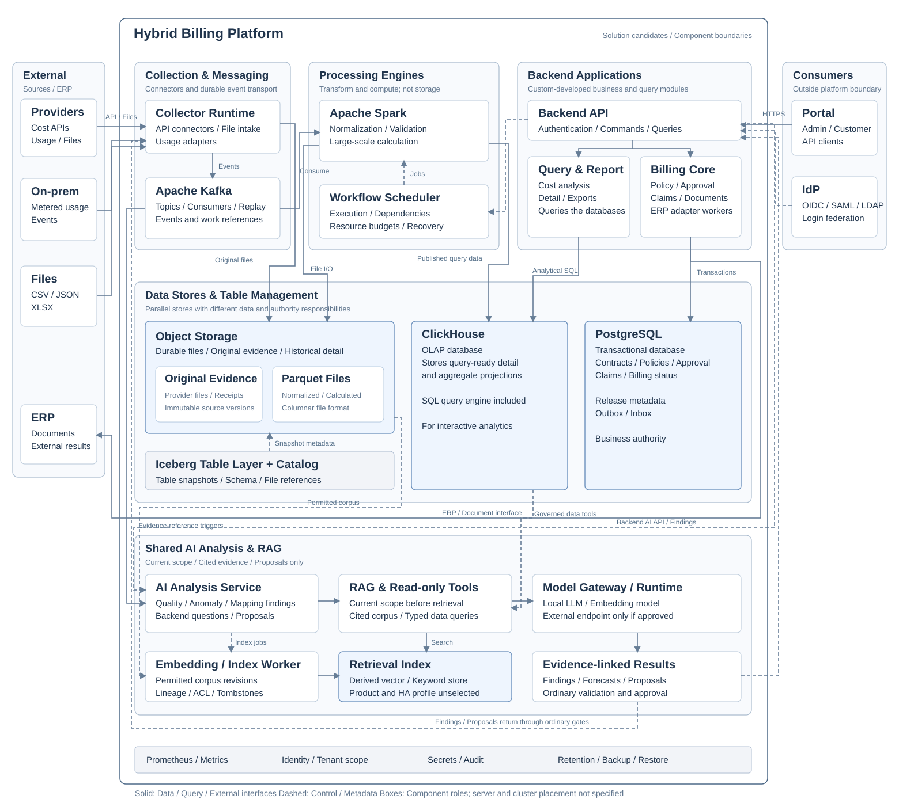
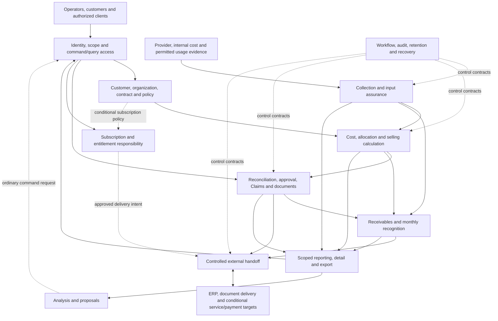
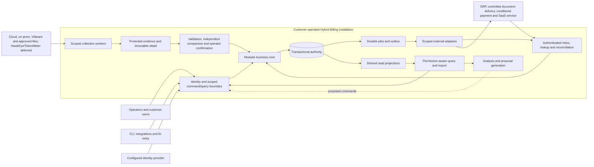

# Backend logical architecture

## Current owner decisions: 2026-10-19

Read the [current design decisions](current-design-decisions.md) first. They supersede conflicting language, deployment, technology-bundle and policy-server assumptions in this historical proposal. Go/Python/React and local Docker are now selected directions; physical engines and production topology are not selected. The historical platform and HA diagrams below illustrate earlier candidates, not a mandatory initial installation. The 2026-10-12 workspace-availability and review statements describe that historical environment, not the present clone.

Date: 2026-10-07. Owner request: draw the high-level architecture before reviewing component data flows and fit-for-purpose configuration. Root owns synthesis; independent architecture/billing/security review is separate. Tracking: [HB-19](https://linear.app/hybrid-billing/issue/HB-19/document-high-level-architecture-and-component-data-flows-before). Accountable owner: Seung Woo Park. Execution machine: `machine:mac_mini`. This is a proposed design, not planning acceptance or product implementation. The previously untracked draft is now published through a ticket branch and independent review.

The solution overview separates collection/messaging, processing engines, backend applications and data stores, with shared AI analysis/RAG. The [original high-level sketch](diagrams/high-level-architecture.svg) remains historical supporting material. The logical responsibility map and F01-F12 contracts explain business ownership; the AI/RAG and HA extension below adds solution integration and failure behavior.

## Historical review basis (2026-10-12)

2026-10-12 owner clarification: restart from the full backend **logical architecture**, at concept level. Define business responsibilities, authoritative ownership and interactions before implementation choices. This revision proposes the organizing map; it does not adopt unresolved business policies. Existing 43-group scope, provider families and conditional/later capabilities remain intact.

Current main basis is `b5c65cf66992f703247b8e4713f86cef7835b767`, including the merged HB-16 input/Claim/numeric and command contracts. The original HB-19 proposal at `83f270a498fbb075db62876dad108b9104df8a53` is revised here rather than creating a competing architecture. SaaS remains the separate [PR14 proposal](https://github.com/myblueton-sw/hybrid_billing/pull/14) at `6acb38c68117ff1f1865776aca00f87c61956196`.

Latest separate capacity/data review input: [HB-20](https://linear.app/hybrid-billing/issue/HB-20), local branch `docs/HB-20-cost-data-review` at `62f7df1`. It records the owner premise of more than 100 million source records/day, object storage/Parquet foundation and MongoDB exclusion. Preserve those inputs; the newer volume supersedes the earlier >1M/day examples as a design premise, not a measured guarantee. Table/catalog/engine proposals in that branch remain unmerged comparison material; this map does not select them.

Required companion rules, bindings and planning inputs are now available in the authorized original workspace. Their prior unavailability was historical evidence from another publication environment. Planning completion remains undeclared; work here is documentation/design only.

## Logical responsibility map

The backend has three interacting concerns: **business authority**, **evidence and calculation**, and **access and delivery**. Cross-cutting governance applies to all three. These are responsibilities, not deployment tiers, process boundaries or database allocations. One module owns each authoritative business decision; another module requests a decision through that owner rather than changing its data directly.

| Logical area | Owns | Collaborates through |
| --- | --- | --- |
| Identity and access | Internal identity, membership/delegation, sessions, current action/row/field authority | Derived authenticated scope and revocation checks for every entry, worker, query and adapter; business owners enforce domain approval constraints too |
| Customer and policy | Party/customer relationships, organizational attribution, contracts and approved effective-dated policy revisions | Fixed revision references supplied to input attribution, calculation and financial workflows; a customer relationship is not automatically a tenant |
| Collection and input assurance | Source connections/identities, receipts, coverage, independent comparison, input decisions and eligible release metadata | Permitted immutable evidence and exact eligible manifests; receipt, normalization and eligibility are distinct states |
| Calculation | Supplier/internal cost interpretation, complete allocation/pricing pools, customer selling results and contribution lineage | Fixed input/policy revisions yield reproducible result releases; calculation never grants financial approval |
| Financial workflow | Reconciliation cases, exact approved snapshots, economic Claims/reservations/reversals, document numbers and issuance intents | Coordinated authoritative transaction for local financial effects and durable dispatch intent; unknown external effects stay pinned |
| Receivables and recognition | Due-date/payment-term snapshots, linked external receipt allocations and separately approved monthly recognition | Verified external/manual authority evidence and purpose-specific intents; invoice, cash, settlement and cost recognition remain independent |
| Integration and service delivery | Transport attempts, verified result correlation; conditional subscription/entitlement domain owns desired/applied service state | Consumes approved owner intents and returns outcome evidence to that owner; transport success cannot grant approval, settlement or access |
| Reporting and intelligence | Rebuildable scoped views, exports, analysis findings and proposals | Reads identified releases plus current authority; proposals re-enter ordinary commands, never write authoritative money |

Workflow orchestration owns scheduling, dependencies, bounded retries and execution progress. It asks domain owners to perform transitions; job success is not business completion. Audit records durable business/security decisions separately from operational telemetry. Retention/recovery owns dependency/hold/control rules; each area must honor current revocation/deletion controls before publishing, serving or resuming work. These controls apply to every area, including those omitted from the overview's dotted arrows.

## Principal logical interactions

1. **Prepare:** approved customer/contract/policy revisions and scoped source assignments define the economic and access context.
2. **Establish inputs:** collect evidence, verify identity/coverage and independent comparison, then explicitly confirm and publish a fixed eligible input release.
3. **Derive amounts:** calculate complete cost/allocation/pricing scopes, publish a fixed result and explain differences; supplier cost, allocated cost and selling charges remain different measures.
4. **Authorize effects:** obtain exact-result financial approval; reserve economic coverage and authorize document/submission intent through the coordinated financial authority. A new run cannot make already consumed coverage available.
5. **Reconcile outcomes:** dispatch a purpose-specific immutable intent, correlate authoritative external evidence and update the owning domain. Monthly recognition has its own approval path independent of invoice cadence; timeout stays unknown until reconciliation.
6. **Explain and correct:** expose authorized detail and lineage from consistent releases. Corrections create linked new revisions and pass the applicable gates; historical issued effects remain traceable. Conditional service grants have their own policy and acknowledgement path.

## Logical consistency boundaries

- **Business authority:** current policy/input/result publication, approval, Claim overlap, balances, document numbering and external intent are authoritative decisions. Coordinate local invariant changes atomically; domain ownership does not authorize eventually consistent financial uniqueness or independent competing ledgers.
- **Evidence authority:** permitted originals and verified immutable input/result detail preserve provenance. Existence of bytes or a processing snapshot is not business eligibility. Publication checks complete references and lifecycle dependencies before advancing an eligible release.
- **Read models:** dashboards, analytics, caches, exports and forecasts are derived. Every view carries scope, revision, completeness and as-of; lag or rebuild cannot authorize money or resurrect access.

These are logical data roles. Object storage/Parquet is a recorded owner foundation from the separate capacity review, while exact table/catalog, transactional technology, messaging products, worker placement and deployment topology require later design. No physical schema, API field-by-field contract, node count or performance commitment is introduced here.

## Unified external gateway and application API layer

Owner requirement: external callers enter through API Gateway under a unified contract, and frontend/backend interaction has an explicit API Layer. Propose one logical public API boundary, implemented by multiple gateway instances across failure domains, routing to two internal API families. This selects no gateway product or deployed path.

| Boundary | Responsibility | Downstream guarantee |
| --- | --- | --- |
| External API Gateway | Public frontend/client/integration, event push, uploads and webhooks; TLS termination, credential/audience validation, admission quotas, bounded request limits, routing and request tracing | Only trusted proxy/service identities reach internal APIs; caller-supplied identity/tenant/approval headers are stripped or rejected. Gateway validation does not grant business approval or replace current authorization |
| Backend API Layer | Portal-facing facade and integration/AI command/query APIs; typed validation, current principal/client/resource/field scope, errors and durable operation replies | Frontend consumes these contracts; it cannot directly reach databases, object/catalog interfaces, Kafka, internal AI/model endpoints or workers. Domain modules retain transaction and approval ownership |
| Collection API Layer | Authorized event/file receipt, source registration and authenticated callback ingestion; service/client scope, source identity/schema and receipt validation | Gateway routes only bounded accepted work to collection; accepted upload/event is not validated eligible input. Internal service-to-service transport may use scoped Kafka/worker protocols |
| Governed query/retrieval boundary | Permission-aware analytical/data tools underneath the API Layer | Current row/field scope before aggregation, search, RAG context and release; public ingress gateway is distinct from this existing query gate |

Use a versioned [OpenAPI-described](https://spec.openapis.org/oas/latest.html) HTTP/JSON contract family for product client APIs: documented request/result schemas, stable canonical IDs, exact decimal strings, explicit timestamp/offset and unit/currency semantics, consistent errors/request IDs and pagination. Common mutation semantics retain command identity, initiating principal/client-bound idempotency digest and expected revision from the [shared command contract](../contracts/commands/planning-actions.md). Asynchronous durable receipt returns an operation/job reference and technical acceptance, not business completion. Streamed/binary uploads use declared bounded content types and the same authentication/error/receipt semantics; internal event envelopes have explicit schema versions rather than forcing arbitrary files/events into a single JSON payload.

Gateway-generated errors use the same safe error/code/trace family. API, worker and domain recheck current authority, financial separation and approved snapshot before execution or protected replay disclosure. No transparent gateway retry may repeat a mutation or unknown external economic effect. The frontend API Client Layer encapsulates versioned calls, session/CSRF integration, safe error handling, request tracing and asynchronous operation-status reads; it holds no authoritative permission or financial logic. A future frontend-specific backend facade may compose scoped reads but cannot recalculate authoritative money or bypass the common command contract. Client generation and compatibility/deprecation policy follow the versioned contract; exact spec/version, limits and field-by-field schemas remain design work.

Ingress covers external-initiated callbacks, including ERP/provider notifications, through gateway authentication plus source-specific signature/audience/replay validation. Provider API pulls, ERP document dispatch, IdP verification and approved model calls are separately governed outbound adapters/egress; they are not reversed through public ingress and cannot bypass inbound gateway policy. Static portal delivery is a separate UI-hosting concern, not a product API permission exception. Bound allowed destinations, redirects and credential audience using the existing [access/trust contract](../contracts/security/access-and-trust.md).

Gateway HA requires redundant instances/endpoints and current shared route/schema/trust configuration, signing-key overlap, session/revocation dependencies and survivor capacity. The stable PostgreSQL writer endpoint is internal and separate from public API ingress. Stale or unavailable authentication/authorization evidence fails closed; no fallback direct-public backend/storage address is allowed during gateway failure. Actual route, bypass, spoofed-header, incompatible-version, mutation-retry, cross-tenant and gateway-failover cases remain NOT_RUN.

## Shared AI analysis and RAG integration

2026-10-12 owner extension: connect both backend applications and data collection to one governed AI analysis/RAG subsystem. The solution preview is supplemented by an [AI/RAG and availability view](diagrams/backend-ai-ha.svg). This is a design proposal; no inference, indexing, customer-data processing or deployment has run.

| Component | Interface and responsibility | Authority boundary |
| --- | --- | --- |
| AI analysis/orchestrator | Backend submits authorized questions/analysis requests; collector/Kafka submits bounded permitted evidence references, scope and revision | Pre-eligibility input may support labeled quality/mapping findings only; analysis cannot publish eligibility |
| RAG retrieval and data tools | Retrieve approved knowledge/evidence slices with source citations; typed read-only tools obtain scoped dataset/aggregate views | Derive current principal/customer/field scope before search, context delivery and output release; no unrestricted model SQL or storage credentials |
| Embedding/index worker | Build derived vector/keyword entries from permitted pinned corpus revisions; record document/chunk/field lineage and permissions | Indexing authority is not retrieval authority; source changes invalidate affected entries; no default capture of raw AI bodies/secrets |
| Retrieval index | Derived vector/keyword store, separate from authoritative financial data; product unselected | Tombstones, holds, revocation and restore control apply to embeddings, index, cache and references; rebuilding uses only still-permitted evidence |
| Model gateway/runtime | Versioned bounded local inference or separately approved external endpoint; isolated service identity and budgets | No default external transmission or tenant-data training grant; retrieved text/model output is untrusted data |
| Result/proposal return | Citation-bearing finding, labeled forecast or revision-bound correction proposal returns to collector/backend workflow | Proposed changes re-enter ordinary deterministic validation and financial commands; no direct approval, ledger or ERP write |

Optional AI/RAG failure returns unavailable/insufficient/stale status and queues bounded replay where permitted. A valid deterministic collection/close path continues; missing mandatory source/permission evidence still blocks the affected business gate. Recovery applies current deletion/revocation controls before index replay or answer release. Existing [intelligence contracts](intelligence-layer.md) govern exact proposal and evaluation semantics.

## HA and failure-domain proposal

The owner asked how HA behaves on failure. Propose three independent failure domains within a supported customer installation. This means distinct correlated-failure boundaries for compute, power, network and storage; it does not mean three total servers, or certify site-level disaster tolerance. Replica counts below are evaluation baselines, not purchased capacity or a production guarantee.

| Area | Proposed redundancy | Failure behavior and activation evidence |
| --- | --- | --- |
| Ingress and stateless services | Redundant ingress/stable service endpoints; at least two API, collector, integration and AI/RAG instances across domains | Health routing plus sufficient survivor capacity; source partitions/checkpoints use leases, generation fencing and idempotent receipt keys; duplicate workers cannot create economic effects |
| Kafka | At least three brokers; three dedicated KRaft controllers across domains; RF3, min ISR2 and producer acks=all as initial policy | One in-sync replica failure can retain the configured write threshold; insufficient ISR/controller quorum stops unsafe progress. Validate relevant internal topics, producer idempotence and disabled unclean elections. Kafka delivery does not make database/ERP writes atomic |
| PostgreSQL authority | Primary plus two standbys; Patroni and three-member DCS as candidates; strict synchronous mode requiring at least one eligible standby acknowledgement | Promote only eligible confirmed candidates under coordination quorum with old-primary fencing and a stable writer endpoint. Loss of safe synchronous/coordination authority blocks financial writes; do not silently switch to async durability. Quorum1 does not imply all standbys contain every acknowledged commit |
| ClickHouse | At least two replicas per shard plus three Keeper members across domains; shard count workload-driven | Route permitted reads only from a replica serving a complete identified release. Proposed two-replica insert acknowledgement pauses new projection publication when either replica is lost; retained input/result releases support later replay. Do not promise continuous writes or authoritative latest reads in that state |
| Object storage and table catalog | Distributed storage and redundant catalog service/control state; exact product/replication or erasure/quorum profile unresolved | Verify physical placement, commit consistency, version references and pin/hold/cleanup behavior. Missing object/catalog proof blocks release publication rather than treating a folder or latest table head as eligible |
| Workflow and compute | Durable domain job state, fenced coordinator/worker claims and restartable deterministic jobs; isolated survivor resource budgets | Lost executors replay exact input/policy releases. Scheduler success is not input eligibility, approval or confirmed external effect. Unknown commits/effects are reconciled under the same intent before redispatch |
| AI model and retrieval dependencies | Multiple gateway/orchestrator instances; redundant model endpoints and HA index profile only when selected and validated | Two gateways do not certify two GPU/model capacities. Index/model failure degrades AI functionality; it cannot bypass scoped evidence or block otherwise valid deterministic closing |
| Identity, keys and operational controls | Include IdP, DNS, certificate/secret custody, audit/retention authority and monitoring in dependency review | Unavailable current authorization fails closed. Stale revocation/deletion state cannot be served from backup or cached as permission. Monitoring is separate from durable security/business audit |

Target: evaluate one failure domain loss with workload admission and sufficient N-1 headroom. Burst intake, monthly close, replay, AI/GPU workloads and maintenance compete for capacity; adding replicas alone is not evidence of survivability. Recovery retains financial Claims and unknown external outcomes, applies latest independent control watermarks and fences old writers before resuming actions.

HA handles selected local faults; independent backups/disaster recovery handle deletion, corruption and site loss. Include PostgreSQL/WAL, original/detail objects, table catalog, policy versions, keys and latest revocation/deletion controls in a coherent recovery plan. RPO/RTO and backup location remain owner decisions; no zero-data-loss or timed-failover claim is made. Fault injection, restore, fencing, monetary replay and N-1 load scenarios remain NOT_RUN.

Capability references checked for this proposal: [Kafka KRaft](https://kafka.apache.org/41/operations/kraft/), [Kafka topic policies](https://kafka.apache.org/41/configuration/topic-configs/), [PostgreSQL replication](https://www.postgresql.org/docs/current/runtime-config-replication.html), [Patroni strict synchronous behavior](https://patroni.readthedocs.io/en/latest/replication_modes.html), [Patroni watchdog/fencing](https://patroni.readthedocs.io/en/latest/watchdog.html), and [ClickHouse replication](https://clickhouse.com/docs/reference/engines/table-engines/mergetree-family/replication). Exact version/profile compatibility and actual host topology remain unselected. Independent review and document/visual QA are recorded in the [verification record](../reviews/HB-19-high-level-architecture/verification.md).

## Architectural direction

Use a **modular business core with separately scalable background workers**, one coordinated transactional authority, durable permitted evidence/detail snapshots, and derived read projections. The boxes below are logical responsibilities, not a commitment to microservices, separate servers or one database per module. The purpose of this review is to agree ownership and data movement before selecting technologies, deployment topology, schemas or capacity.

The core distinguishes supplier cost, customer selling charge and internal allocation. It also distinguishes billing calculations, source confirmation, human financial approval, document issuance, cash settlement, monthly ERP cost recognition and service access. No single status or aggregate can stand in for all these concepts.

## System context and trust boundary

Solid arrows describe permitted data/control relationships at context level, not unrestricted network access. The detailed flow IDs below identify the actual kind of movement. Every command, worker, query and external adapter rechecks current scoped authority; a queue or internal network does not grant trust. No user, AI agent or adapter has direct unrestricted storage access. An external service URL cannot select the workspace or credential audience.

## Billing and subscription flow

```mermaid
flowchart LR
    S[Source evidence] --> R[Receipt and quarantine]
    R --> N[Normalize, deduplicate and verify full coverage]
    N --> X[Independent cross-validation]
    X --> IC[Scoped operator input confirmation]
    IC --> M[Fixed eligible input manifest]
    P[Approved contract, rate, FX and allocation revisions] --> C
    M --> C[Deterministic allocation and charge calculation]
    C --> RC[Reconciliation and warning resolution]
    RC --> A[Human fixed-amount approval]
    A --> F[Authorized Claim and issuance/submission transaction]
    F --> O[Outbox and purpose-specific dispatch]
    O --> E[ERP, document or conditional payment adapter]
    E --> V[Authoritative external confirmation]
    V --> T[Transactional result and receipt allocation]
    M --> RB[Monthly cost recognition batch]
    P --> RB
    RB --> RA[Separate reconciliation and approval]
    RA --> O
    SC[SaaS contract and catalog revisions: PR14 proposal] --> P
    SC --> EP[Approved service entitlement policy]
    EP --> ED[Versioned desired grant and scoped delivery]
    ED --> ES[SaaS service acknowledgement: actual grant state]
```

The recognition path uses eligible source/calculation revisions on the required monthly basis; it does not wait for customer invoice cadence or begin Payment Terms. A recognized amount is not necessarily the customer selling amount. Purpose-specific ERP treatment prevents the later invoice from recognizing the same cost again. SaaS revenue/deferred-revenue policy is separately unresolved.

The entitlement path is not an invoice or payment side effect. Its policy can inspect sufficiently current contractual/payment evidence through authorized reads; desired state differs from confirmed applied state. Grace, suspension and reactivation are approved rules. A successful payment does not grant tenant access, and service expiry does not itself delete historical billing evidence.

Issued documents and confirmed posting history remain immutable. A correction creates new linked evidence and re-enters the applicable validation, calculation, reconciliation and approval gates, then produces an authorized adjustment/reversal with external confirmation rather than overwriting the original. Closed-period changes use approved open-period adjustments linked to the original attribution period. Invoice cancellation does not automatically cancel monthly recognition, reverse a receipt or trigger a cash refund; each affected authority and outcome is reconciled separately.

## Component responsibilities and configuration questions

| Component | Purpose, inputs and outputs | Authoritative owner and next configuration review |
| --- | --- | --- |
| Access and command/query boundary | Authenticate human/service identity, derive tenant/customer/action/field scope and accept bounded commands or permitted queries | Identity/access module owns grants, sessions and revocation. Review IdP, service credentials, command registry, segregation and propagation; no product selected. |
| Customer, contract and policy modules | Effective-dated Party/customer/org relationships, price/allocation/FX/tax rules and Payment Terms; proposed SaaS catalog/subscriptions | Core owns approved revisions and their activation. Review policy precision, effective-time overlaps, seat/meter definitions and approval ceilings. |
| Collection adapters/workers | API pulls, bounded uploads, push/events and controlled file ingestion; register permitted bytes, scope, identity and receipt state | Source module owns receipt/evidence metadata. Review provider capability profiles, credential audiences, quotas, checkpoint/coverage semantics and fetch policy. |
| Evidence and eligibility pipeline | Quarantine conflicts/incomplete input; normalize, verify source coverage, compare independent evidence and obtain operator confirmation | Input module publishes the eligible manifest only after all required checks. Review complete-snapshot/append/hybrid and cross-transport precedence. |
| Allocation and pricing workers | Fixed manifest plus approved policy revisions produces deterministic cost/allocation/selling components and lineage | Core owns calculation publication and approved results; workers cannot self-approve. Review decimal bounds, pools, rounding, correction and reproducibility. |
| Reconciliation and financial workflow | Explain differences, bind warning acknowledgments and human approval to exact evidence; reserve/apply economic Claims and authorize issuance | Financial authority coordinates approval digest, Claim consumption, numbering, document/submission intent and outbox atomically where local. Review reservation/concurrency and external uncertainty. |
| Recognition and receivable modules | Monthly cost batches, purpose-specific ERP comparison, confirmed receipts/reversals and due/overdue as-of | One selected external/manual receivable/cash authority per profile; platform holds linked evidence, not an independent bank ledger. Review books, basis, freshness and anti-double-recognition mapping. |
| Jobs, outbox/inbox and adapters | Dispatch approved immutable intent, lookup/reconcile external results, retry only safe unresolved work | Core owns durable intent and outcome; adapters own transport only. Review leases, bounded retries, ordering, idempotency, dead-letter/manual recovery and fencing. Broker is optional. |
| SaaS entitlements and payment adapters | PR14 proposal: contract/service policy produces versioned desired grants; processor and target service return authenticated evidence | Service delivery and payment are separate state machines. Review mandates, provider events, credit/refund conservation and acknowledgement; no automatic debit approval is implied. |
| Query, export and analytics | Build reproducible scoped views over fixed evidence and derived projections; disclose completeness and freshness | Query gateway enforces current permission before aggregation and output release. Review query shapes, storage/read workload, export revocation and hidden-field inference. |
| Intelligence | Detect anomalies and propose corrections/forecasts from permitted, traceable input | Derived advisory output only. Changes return through the same command/approval gates; models cannot calculate authoritative money or directly write ledgers. Review model/data boundary and evaluation. |
| Operations and governance | Secrets/key custody, durable business/security audit, redacted telemetry, dependency-aware retention and coherent recovery | Distinct operational/financial authority. Review holds, deletion watermarks, backup/restore, writer fencing and external reconciliation before reopening. |

## Storage roles

| Logical storage role | Contains | Must not be mistaken for |
| --- | --- | --- |
| Transactional authority | Tenant/permission/policy revisions, manifests, approved snapshots, Claims, reservations, numbers, financial evidence metadata, submission ledger, durable job/outbox/inbox state and audit records | A place for raw secret payloads or a claim that external payment/ERP transactions are locally atomic |
| Protected evidence/detail store | Permitted originals, fixed normalized/calculation partitions, source lineage, issued artifacts and retained versions | Arbitrary raw customer payload capture, temporary exports, or inputs automatically eligible merely because bytes exist |
| Derived read projections/cache | Versioned analytical views, search/reporting and operational summaries with source revision/completeness/as-of | Financial truth, a second receipt ledger, or a permission bypass; a projection may be rebuilt only from still-permitted retained evidence |

Metadata references immutable detail by manifest, digest and canonical economic identity. Stage and verify complete bytes before publishing authoritative eligibility; transactional publication and object writes are not a distributed atomic transaction. Read visibility follows authoritative manifest status. Orphan/stale artifacts remain noneligible until reconciliation and retention policy resolve them. A separate analytical store or broker must justify its operational cost with actual workload evidence.

## Numbered data-flow contracts

| ID / kind | From → to | Payload and gate | Failure or correction behavior |
| --- | --- | --- | --- |
| F01 command | User/client → access → owning core module | Current principal/scope, command, expected revision, idempotency key and bounded parameters | Reject stale/revoked/unauthorized commands; source caller's tenant parameter is not authority. |
| F02 evidence | Provider/file → collection → protected staging | Permitted bytes, provider/account/period, source identity, content hash and received time | Partial receipt stays incomplete; conflicting same identity is quarantined. No billing eligibility yet. |
| F03 publication | Staging/normalization → eligible input registry | Verified partitions/coverage, source modes, independent comparison and exact operator confirmation | Missing coverage or changed confirmed digest blocks publication; late evidence is a new linked revision. |
| F04 compute | Eligible manifest + approved policies → calculation | Fixed units/currencies/bases, complete allowance/allocation pools and exact engine/rule revisions | Same inputs reproduce amounts; overflow/undefined rules stop. Different chunks cannot reapply allowances. |
| F05 financial command | Reconciled result + human approval → financial authority | Fixed evidence/amount digest, current approver/issuer authority, economic Claim and intent | Changed inputs invalidate draft approval; concurrent runs cannot spend the same Claim/credit twice. Issued-history corrections use linked adjustments through the same gates, never overwrite. |
| F06 external intent | Committed outbox → adapter → ERP/document/payment target | Approved snapshot reference, purpose, target account/entity, correlation and idempotency identity | Timeout is unknown; lookup/reconcile original effect before redispatch. Transport receipt is not business completion. |
| F07 result evidence | External target → authenticated inbox/lookup → core | External document/attempt identity, verified state/amount/currency/as-of and linked original intent | Validate audience/signature as applicable; wrong-account/conflicting/out-of-order events cannot settle another invoice. |
| F08 recognition | Eligible period evidence → approved monthly batch → ERP adapter | Separate entity/books/basis/period and purpose-specific submission; linked net adjustments | Missing months are unknown; invoice does not create recognition again without verified offset/reversal/reference treatment. Closed-period corrections post authorized open-period adjustments linked to original history. |
| F09 SaaS state | Subscription/service policy → entitlement outbox → target → acknowledgment | PR14 proposal: desired grant revision, current scope and separate confirmed applied revision | Stale events cannot regrant access; delivery unknown is visible; no inferred refund or invoice cancellation. |
| F10 read | Authority/detail → projections → authorized query/export → user | Fixed source revision, permitted fields/rows, currency/basis, completeness and as-of | Permission applied before aggregation and at release; stale projection cannot authorize financial commands. |
| F11 proposal | Authorized query → intelligence → ordinary command request | Evidence-linked anomaly/correction proposal or labeled forecast | No direct financial/storage write or automatic approval; training requires its own approved contract. |
| F12 recovery/control | Retention/revocation authority → restore/replay/dispatch | Latest independent control watermarks, held dependencies and active writer generation | Fence old writers; prevent data/access resurrection and reconcile external uncertainty before reopening. |

## Review conclusions and decisions to make next

The published logical direction is suitable as a review starting point because it separates financial authority, bulk evidence processing and read workloads. This is a design inference, not performance or compatibility proof. Keep the first architecture choice at module/data-ownership level; an arrow or box does not establish a deployable microservice.

Review in dependency order:

1. Approve or revise module responsibilities, permitted flows and external trust boundaries, including the PR14 SaaS proposal.
2. Specify transaction boundaries, input publication, economic uniqueness, correction/reconciliation and entitlement/payment state contracts.
3. Define exact command/event/query envelopes and source/target capability profiles, with independent monetary and tenant-isolation acceptance cases.
4. Measure arrival bursts, record/detail expansion, monthly close, correction/replay, query concurrency, retention and catch-up requirements; the latest >100M source records/day premise from the separate HB-20 review is not a node-sizing answer.
5. Compare storage, queue, cache and worker configurations against those responsibilities; then choose VM/container or customer-operated Kubernetes placement and recovery topology.
6. Reconcile the full requirement/work/API/screen/acceptance trace and obtain the owner's explicit planning completion before implementation.

No language, framework, database product, broker, cloud service, node count, operating budget or SLA is selected here. Existing PostgreSQL/ClickHouse/Kafka/OpenTelemetry assessments remain candidate analysis. Full provider scope and customer-operated delivery are preserved.

## Source and verification record

Source documents read from the repository baseline: [readiness](architecture-readiness.md), [technology](technology-assessment.md), [installation](self-hosted-installation-assessment.md), [collection](data-collection.md), [billing ownership](data-ownership/billing-data-model.md), [administration](admin-design.md), [intelligence](intelligence-layer.md), [input/pricing/ERP contracts](../contracts/billing/inputs-pricing-and-erp.md), [payment/recognition](../contracts/billing/payment-and-recognition.md) and [security](../contracts/security/access-and-trust.md). The HB-18 supplement is read from the separately proposed PR14 head identified above. This is synthesis of repository evidence, not a new external standards/vendor audit.

Historical publication context: browser access to the actual Hybrid Billing workspace was restored before the original HB-19 publication; its machine claim was subsequently released. The 2026-10-12 revision rechecks the authorized workspace, accountable owner and machine ownership. The current review basis above supersedes historical input-availability statements without certifying fresh-clone portability.

Independent review, publication checks and limits are recorded in the [HB-19 verification report](../reviews/HB-19-high-level-architecture/verification.md). Runtime, financial execution, security enforcement, provider/ERP compatibility, load/recovery, user-task and accessibility validation are NOT_RUN. Final policy values, exact command contracts and physical design remain unresolved.
